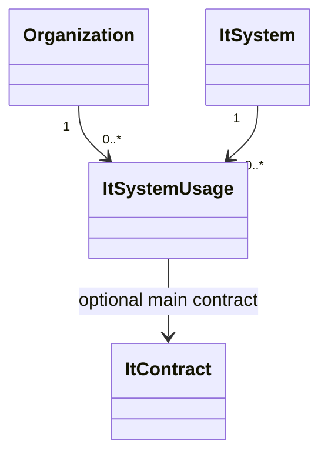
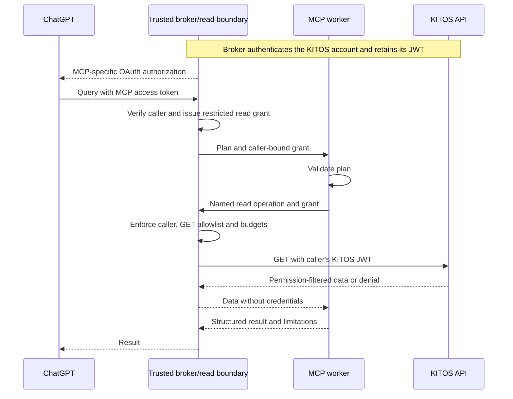

# Software Architecture and Design: KITOS MCP Server

## 1 Introduction

Enable external agents to answer questions across KITOS through a read-only remote MCP service. The first integration targets ChatGPT on the web, one existing KITOS API user, catalog discovery and a system-name query. No external IdP, custom chat UI or public plugin publication is required.

Delivery strategy: a walking skeleton first, followed by thin vertical functional slices. Existing catalog/validation/read-policy code is supporting work; it has not proved an end-to-end user outcome. Reuse it where it serves the first flow, and track functional progress in the [implementation checklist](kitos-mcp-server-implementation.md).

## 2 Analysis

REQ-2.01: External LLM agents shall query KITOS data through an MCP server.

REQ-2.02: Queries shall support combining related model objects, rather than only extracting individual objects.

REQ-2.03: Danish natural-language questions are the target; English-only support is an acceptable MVP fallback if Danish proves impractical.

REQ-2.04: The design shall address diverse questions across the entire KITOS data model; it shall not specialize in municipality adoption counts.

REQ-2.05: Every query shall run with the caller's KITOS read permissions, including organization membership, sharing, and API-access restrictions; the MCP integration shall not grant additional visibility.

REQ-2.06: Results shall distinguish accessible-data coverage, execution completeness, and temporal consistency. A complete retrieval shall not be described as a national total or a point-in-time snapshot without supporting evidence.

REQ-2.07: The first integration MVP shall let one existing KITOS API user connect ChatGPT on the web, discover the catalog, and execute one read-only system-list query under that user's current KITOS permissions.

### 2.1 Domain Description

Use Danish UI vocabulary, including `IT-snitflader`, `IT-Systemer i anvendelse` and `Databehandling`. Distinguish shared catalog **IT systems** from an organization's local **system usages**. Names can be ambiguous; resolve identity by UUID. Municipality classification uses organization type, not its name.

Cross-organization reads follow existing memberships and shared/public visibility; they do not inherently require global-admin access. Local admin does not grant national visibility, and inaccessible private records remain outside the answer. No shared global-admin reporting identity is proposed.

### 2.2 Object Model

A QueryPlan describes entity, filters, traversal and projection, with grouping/aggregation as future capabilities. QueryResult carries data, interpretation, evidence, coverage, execution completeness, retrieval interval, consistency status and catalog version.

### 2.3 Dynamic Model

The agent discovers capabilities, clarifies ambiguous identities, submits a structured plan and explains the result. The server validates the plan, composes authorized REST reads and performs deterministic processing. Unsupported operations return explicit limitations; the question must not be silently reinterpreted.

### 2.4 Scenarios

- First integration: find catalog systems whose name contains a known term; compare caller-visible results with a controlled fixture and disclose paging/limit shortfalls.
- Broader design: join related systems, usages, organizations, contracts, interfaces and data-processing registrations; define counting/aggregate semantics before execution.
- Ambiguous, denied, interrupted or concurrently changed data: clarify or report the limitation; distinguish complete zero results from incomplete retrieval.

### 2.5 Sequence Diagrams

Runtime flow; the local broker/worker path is implemented, while ChatGPT acceptance remains pending:

### 2.6 State Machines

Skipped: no separate model-entity lifecycle is introduced. Delegation expiry/revocation is covered in section 4.3.

## 3 Design

### 3.1 Subsystems

| Component | Responsibility |
|---|---|
| MCP worker | Catalog discovery, typed tools, plan validation and deterministic query processing. |
| Trusted broker | Adapt existing KITOS authentication to ChatGPT OAuth; manage caller consent and read delegation. |
| Independent read boundary | Retain upstream credentials; enforce fixed GET capabilities, caller binding and budgets. |
| KITOS API | Authenticate the KITOS user and enforce current API/data permissions. |

Broker and read gateway share a trusted service, independently deployed/administered from MCP. W01 exposes `get_domain_catalog` and `query_kitos` for one system-name query; `resolve_entities` and broader execution are deferred.

The core validator supports exact catalog IDs, AND filters, projections and explicitly declared single-reference traversal prefixes. W01 execution permits only systems with UUID/name projection and one name-contains filter. Collection traversal, joins, grouping and aggregation remain unimplemented; a declared relationship does not imply executable support.

### 3.2 User Interface

ChatGPT presents answers and clarification. Users authenticate through a trusted credential flow, never by supplying secrets in chat/tool arguments. Answers state interpretation, accessible scope, completeness and retrieval interval; they must not imply national coverage or a snapshot without evidence.

## 4 Architecture

### 4.1 Service Boundaries and Transport

REQ-4.01: The external LLM agent shall interpret natural language. The MCP server shall provide domain guidance and deterministic query tools without hosting its own LLM.

REQ-4.07: The first implementation shall expose remote MCP over Streamable HTTP with HTTPS and authenticated caller access. Broker and worker shall first be exercised locally over HTTPS; stdio transport and local bridges are outside scope.

Keep the query core transport-independent. ChatGPT's initial connection uses OAuth backed by KITOS authentication; actual workspace/client compatibility must be verified. Authenticate every request, validate supplied Origin headers and bind sessions to the caller; a session ID is not an authentication credential.

### 4.2 Read-Only Security Boundary

REQ-4.02: KITOS data access from this integration shall permit only explicitly allowlisted REST GET routes. An enforcement boundary outside the MCP process shall deny POST, PUT, PATCH, DELETE, method overrides, unlisted routes, and redirects to unapproved destinations, even if MCP validation is bypassed. This concerns downstream KITOS data calls; MCP transport may itself use POST.

REQ-4.03: Compromise of the MCP component shall not yield KITOS database access, signing keys, administrator/service credentials, or credentials usable for writes. Read-only protection shall also hold against credential replay directly to KITOS, not just requests through the adapter.

**Decision: independent credential-holding boundary (option A).** Ordinary KITOS JWTs can authorize external API writes; KITOS's HMAC signing key also permits token minting. Both stay outside MCP. The trusted boundary owns credentials, policy and administration under separate identities/storage/configuration; MCP cannot access its control plane or KITOS database.

MCP submits a named operation with bounded parameters and an opaque caller-bound grant. The boundary determines identity/credentials from trusted state and constructs the destination, GET method and authorization itself. Reject arbitrary URLs, methods, headers, credential references and user IDs. Workload identity alone grants no caller authority. Data egress is confined to the boundary; policy changes are independently administered, not driven by catalog edits.

Allow only `GET /api/v2/it-systems` with `nameContains`, `page` and `pageSize`; source review found no registration mutations on this route. W01 uses the first page of up to 100 non-deactivated systems. Disable redirects/cookies, strip credential-bearing response headers, enforce response schemas and fail closed on missing policy/state. Trusted login/token validation is a separate control-plane path, not a data-read capability.

A compromised MCP can still leak caller-visible data or falsify answers. The trusted boundary remains security-critical: its compromise can expose ordinary upstream credentials.

### 4.3 Authentication and Data Visibility

REQ-4.04: Downstream reads shall use a KITOS JWT bound to the authenticated caller. KITOS shall validate the token and enforce current API/data permissions for each request; identities shall not be selected by tool arguments, and failed/expired authorization shall never fall back to a privileged account.

REQ-4.08: MCP caller identities and data permissions shall derive from existing KITOS users, roles and access rules. The integration shall not require an external identity provider or maintain a separate user/role directory.

REQ-4.09: The MCP integration shall adapt existing KITOS authentication without requiring changes to KITOS's existing authentication flow.

**Decision:** KITOS supplies identity and permissions. Broker scopes/consent only restrict delegation. MCP authorization, boundary grants and upstream KITOS JWTs are distinct credentials; never forward ChatGPT's bearer token to KITOS or expose the KITOS JWT to MCP.

KITOS currently offers cookie/JWT authentication and API-token issuance/validation, not an OAuth authorization-code server. The separate trusted broker provides ChatGPT's OAuth protocol without replacing KITOS login or introducing users/roles. **W01 login decision:** the user obtains a JWT through existing KITOS login and manually pastes it into the broker's trusted HTTPS page. The integration does not collect KITOS passwords or assume access to a KITOS browser/SSO session.

Validate the pasted JWT through the fixed KITOS instance's `/api/v2/token/validate`; derive instance/user identity and expiry from verified results, then confirm current API access through a reviewed GET. JWT possession authenticates that bearer account, not an independently proven human identity. Introspection alone does not establish data permissions. On expiry, the user obtains and pastes a fresh token; no automatic KITOS credential renewal is assumed.

Use a maintained OAuth implementation with audience validation, authorization-code/PKCE, exact redirects, consent and CSRF/replay protection. Broker signing keys stay outside MCP; only public verification material may be shared. Trusted ingress validates each request and removes spoofable context headers. Grants bind caller, client/workload, allowed operations, credential version and expiry; MCP cannot mint or broaden them.

W01 uses mTLS between workloads and bounded in-memory credential/grant state in one trusted instance. The broker exposes public OAuth/MCP HTTPS without requesting browser client certificates; a separate, unpublished read listener requires the pinned worker certificate and permits only `POST /reads`. Requests are bound to their actual listener: public requests cannot reach the read plane, and private read connections cannot reach OAuth. Restart disconnects users and requires fresh token entry; no durable credentials or replicas are supported. Replacement/disconnect revokes old grants atomically; renewal must retain the account identity. Account switching requires explicit logout/new login. Durable encrypted PostgreSQL/EF Core storage and cross-replica coordination are deferred.

Broker authorization cannot extend beyond the underlying KITOS JWT; grants are additionally capped by the MCP access-token expiry. No silent password-based renewal or privileged fallback. KITOS browser logout is not assumed to revoke an API JWT; an already dispatched GET cannot be recalled. Existing KITOS permissions remain authoritative on subsequent requests.

### 4.4 Domain Guardrails and Resource Limits

REQ-4.05: Query validation shall enforce the domain catalog and finite limits on pages, requests, traversal depth, duration, concurrency, and result size. Invalid plans shall cause no KITOS data requests; limits reached during execution shall produce explicit incomplete outcomes.

REQ-4.06: Credentials shall not appear in prompts, tool results, logs, or persistent MCP caches. Results shall not be reused across callers or authorization contexts; retrieved free text shall remain untrusted data and shall never change execution instructions.

Allow only catalog-defined KITOS concepts/operators; no arbitrary SQL, code or general web/search tools. Prompt guidance and MCP read-only annotations are not security enforcement. Keep free text as data, and do not reuse results across authorization contexts.

The bilingual vocabulary is a versioned embedded JSON resource, loaded once into validated immutable indexes; executable rules remain in code. It grows with schema concepts, not KITOS registration volume. Live catalog editing/database storage is deferred.

| Boundary | Current limits or proposed defaults |
|---|---|
| Implemented plan validation | 16 KiB JSON; 16 projections/filters; 8 traversals, depth 3; text 256 and paths 128 characters. |
| Implemented read-request policy | 4 KiB strict JSON; text 256; page 0–999; pageSize 1–250, default 100; one GET description. |
| Pilot runtime | Grant up to 5 minutes, bounded by both token expiries; 10-second upstream timeout; 2 MiB response; no automatic retries/redirects. |
| Single-instance admission | 2 active requests and 30 per rolling minute per KITOS instance/user; 16 active per deployment; no unbounded queue. |

Runtime defaults are not capacity guarantees. Enforce timeout/body limits while reading, before unbounded buffering. Quotas must be atomic across grants/clients/replicas; store failure denies admission. Later pagination requires its own total query budget. Limits/failures produce explicit incomplete outcomes, never empty-success results.

### 4.5 Consistency and API Compatibility

Reads are `best_effort` over the retrieval interval, not a transactional snapshot. Concurrent inserts/deletes can shift pages; edits can change filters or join states. Deduplicate identities and use stable ordering, but do not promise no omissions. Detected change reports `change_detected`; failed required pages/joins report incomplete execution. Undetected changes remain possible.

Version catalog/API mappings and reject incompatible responses. Exact snapshots require separately scoped backend versioned-read/export support.

### 4.6 Delivery Risks and Remaining Decisions

Resolve before live authentication: trusted origins, workload certificate ownership and isolated signing-key/state management. OpenAI Secure MCP Tunnel is selected for W01 ChatGPT testing. It can reach a private/local HTTP server, but does not automatically tunnel the OAuth server; OAuth reachability and client/resource binding remain acceptance prerequisites. The canonical OAuth resource is configured separately from the broker listener/issuer when the tunnel presents its own resource identifier. Metadata, authorization, token audience and validation must use that same exact configured identifier; accepting arbitrary caller-supplied resources is forbidden. The pilot may enable public-client registration for one preconfigured client and the exact callback supplied by ChatGPT's management UI; this neither admits arbitrary callbacks nor grants KITOS access. Registration retains authorization-code/S256 PKCE, token authentication `none` and the sole `kitos.read` scope. Inspector and ChatGPT configurations are selected separately; switching restarts the broker and requires fresh authorization. No real credentials may be used with missing or permissive defaults.

Broader release decisions: mandatory question/model coverage; adoption/current-use and unknown-value semantics; national/private reporting needs; compositional versus additional domain tools; snapshot requirements; performance targets. Risks include REST fan-out, missing joins, ambiguous language and incomplete registrations.

## 5 Implementation

W01 is the active walking skeleton for REQ-2.07: one existing KITOS API user connects ChatGPT, requests systems matching a known term, and receives UUID/name plus accessible-scope/completeness information from one real authorized KITOS GET. Local integration and the expected staging query/coverage through ChatGPT are confirmed; live denied-permission acceptance remains pending. Broaden capabilities only after this path is verified.

Treat login, delegation and transport as supporting tasks inside W01, with integration exercised early. A local rig may prove real protocol/API seams before the ChatGPT demonstration, but cannot replace intended-client acceptance. Resolve only choices needed for this path; select a maintained OAuth implementation and enforce the agreed separate trust boundary, caller permissions, GET/replay protection and finite limits from the outset. Do not build comprehensive grant/storage/query frameworks first or introduce a privileged/mock authentication shortcut.

The approved single-instance pilot first runs broker and worker locally over HTTPS, using ephemeral trusted state and configurable `https://staging.kitos.dk`. Separate processes alone do not isolate credentials: live-token use requires separate OS/container identities and private key mounts. Local protocol validation precedes the ChatGPT acceptance. Subsequent slices extend useful scenarios (for example complete bounded paging or one relationship query).

Acceptance covers known fixture answers under ordinary users, malformed/unsupported plans, direct boundary bypass and credential replay, expiry/revocation/cross-caller isolation, finite budgets, interrupted/concurrent reads and incompatible schemas. Test interpretation separately from deterministic query correctness; pass the project gate and inspect the actual runtime boundary before marking a chunk complete. No full integration or security acceptance is inferred from the existing pure-core tests.

## 6 References

- [Domain vocabulary](../../Mcp.Core/Resources/domain-catalog.v1.json) and [plan validation](../../Mcp.Core/QueryPlanValidator.cs).
- [Independent read policy](../../Mcp.ReadBoundary.Core/ReadRequestPolicy.cs).
- [KITOS token issuance/validation](../../Core.ApplicationServices/Authentication/TokenValidator.cs) and [authentication configuration](../../Presentation.Web/Infrastructure/Configuration/AuthenticationServiceCollectionExtensions.cs).
- [ChatGPT custom MCP connections](https://developers.openai.com/api/docs/guides/custom-mcp-server).
- [OpenAI Secure MCP Tunnel](https://developers.openai.com/api/docs/guides/secure-mcp-tunnels).
- [MCP authorization](https://modelcontextprotocol.io/specification/2025-11-25/basic/authorization) and [security guidance](https://modelcontextprotocol.io/docs/2026-07-28/tutorials/security/security_best_practices).

## 7 Appendix A

Skipped: detailed evidence belongs in tests/reports linked from the implementation checklist.
