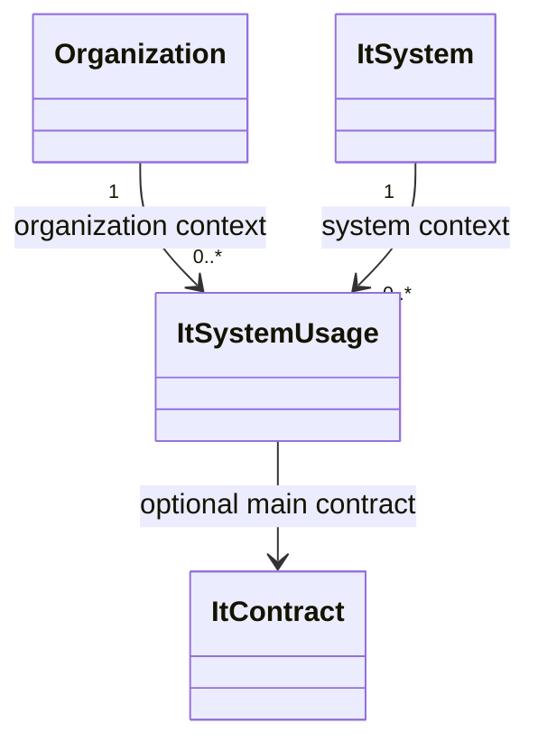
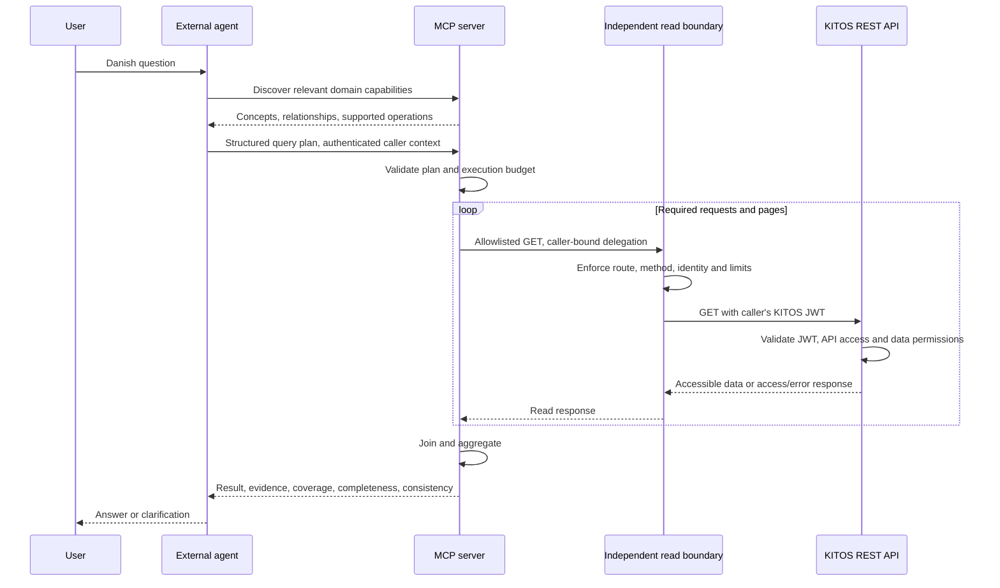

# Software Architecture and Design: KITOS MCP Server

## 1 Introduction

Status: First catalog/query-validation slice implemented and verified. Implementation is authorized; the complete remote MCP release is not yet scoped or implemented.

Decision: the first implementation supports a centrally hosted remote MCP service only. Local MCP deployment, stdio transport, and local bridges are deferred.

Enable external LLM agents to answer questions across KITOS by composing queries over its REST API. The municipality-adoption question is one worked example, not the product scope. Update this document as requirements and decisions evolve.

## 2 Analysis

REQ-2.01: External LLM agents shall query KITOS data through an MCP server.

REQ-2.02: Queries shall support combining related model objects, rather than only extracting individual objects.

REQ-2.03: Danish natural-language questions are the target; English-only support is an acceptable MVP fallback if Danish proves impractical.

REQ-2.04: The design shall address diverse questions across the entire KITOS data model; it shall not specialize in municipality adoption counts.

REQ-2.05: Every query shall run with the caller's KITOS read permissions, including organization membership, sharing, and API-access restrictions; the MCP integration shall not grant additional visibility.

REQ-2.06: Results shall distinguish accessible-data coverage, execution completeness, and temporal consistency. A complete retrieval shall not be described as a national total or a point-in-time snapshot without supporting evidence.

Proposed acceptance: evaluate varied questions about systems, usages, organizations, contracts, interfaces, and data processing registrations, including multi-hop relationships and aggregates. Verify interpretation and computed results separately.

Open question: which question families and model coverage are mandatory for the first release?

### 2.1 Domain Description

Observed: V2 external APIs expose authenticated, access-filtered reads. An IT system is product master data; an IT system usage is an organization's local registration of that system.

| Danish term | KITOS meaning | Qualification |
|---|---|---|
| IT-system | ItSystem | Resolve names to UUIDs; names can be ambiguous. |
| IT-system i anvendelse / ibrugtagning | ItSystemUsage | Organization-local registration of a catalog system; registration, lifecycle, and validity differ. |
| Kommune | Organization with Municipality type | Classify by type, not name. |
| Hvor mange | Aggregate | Define counting unit; deduplicate by identity. |

Proposed: a versioned domain catalog describes all model areas, Danish/English terminology, fields, relationships, enumerations, computed semantics, and executable capabilities. OpenAPI can seed API metadata; domain meanings and joins require explicit mappings.

Agreed naming rule: use KITOS UI concepts as the primary Danish vocabulary, verified against frontend labels rather than translating CLR/API class names. Current examples: `IT-snitflader`, `IT-Systemer i anvendelse`, and `Databehandling`. UI context matters: `IT Systemkatalog` describes product master data, while an organization's `IT Systemer` view describes usages. Discovery must explain that distinction. Additional synonyms can follow observed question patterns; assume neither that every user uses the same wording nor that a UI label uniquely identifies an entity.

Observed access model: organization membership permits local reads; municipality membership or stakeholder access can permit shared/public reads across organizations. Rights-holder access has separate restrictions. Global admin receives unrestricted cross-organization read access, subject to the relevant endpoint's rules. Cross-organization questions therefore do not inherently require admin rights. Private data outside existing memberships requires additional authorized access; local admin does not imply national visibility.

Proposed: default to caller-visible answers and label the coverage. Do not use a shared global-admin identity to answer national questions. A future national reporting identity must have explicitly approved, read-only visibility; such a role is not established by this design.

Open questions: adoption/current-use semantics; whether national/private-data reporting is required; handling unknown or unregistered values. These apply beyond the example.

### 2.2 Object Model

Illustrative existing relationships; catalog coverage must extend beyond these entities:



Proposed query objects: QueryPlan (entity, filters, traversal, projection, grouping, aggregation); QueryResult (data, interpretation, evidence, coverage, execution completeness, retrieval start/end, consistency status, warnings, catalog version). Consistency status is `best_effort` unless the backend supplies a verifiable snapshot; detected changes additionally report `change_detected`.

### 2.3 Dynamic Model

Proposed: agent reads relevant catalog entries, resolves ambiguous identities, builds a structured plan, and submits it. The server validates supported operations, maps them to REST requests, pushes down supported filters, traverses relationships, and aggregates deterministically. The agent explains the result in the user's language.

Unsupported relationships or operators return an explicit capability limitation. Do not invent results or silently change the question.

Guardrails are deterministic server controls: accept only catalog-defined KITOS entities, fields, relationships, and operators; reject arbitrary URLs, SQL, executable expressions, and unbounded traversal before fetching data. No general web/search or code-execution tool is exposed. These controls bound what MCP can do; the external agent remains responsible for staying on topic in its conversation and for presenting supported conclusions.

### 2.4 Scenarios

- Adoption example: resolve 'KOMBIT beskedfordeler'; retrieve usages; join organizations by UUID; apply agreed adoption/type predicates; count distinct organization UUIDs.
- Broader queries: filter contracts by relevant dates; traverse systems and interfaces; compare organizations' portfolios; relate data processing registrations to usages. Exact executability requires catalog/API mapping.
- Ambiguous identity or meaning: return candidates/clarification needs; the agent asks the user.
- Empty complete results: report zero. Missing access, failed pages, unknown classifications, or execution limits: report the limitation separately.
- Compromised MCP process: an independent boundary rejects non-GET and unlisted KITOS routes; stolen integration credentials cannot authorize writes through another route (REQ-4.02, REQ-4.03).
- Concurrent edit/delete: an object may change between pages or disappear before a join. Return a change warning or incomplete outcome when detectable; never treat a failed required join as a complete count. Undetected changes remain possible.
- Cross-organization comparison: include only records KITOS makes accessible; explain that shared/public or membership coverage can exclude private registrations. Do not infer hidden record counts.

Observed example routes: `GET /api/v2/it-systems?nameContains=...`, `GET /api/v2/it-system-usages?systemUuid=...`, and `GET /api/v2/organizations`. Usage organization references are shallow; classification requires organization data.

### 2.5 Sequence Diagrams

Proposed interaction:



### 2.6 State Machines

Skipped: no persistent feature-specific lifecycle is currently proposed; request validation and execution outcomes are described above.

## 3 Design

### 3.1 Subsystems

Proposed responsibilities:

| Component | Responsibility |
|---|---|
| MCP surface | Typed tool contracts and structured results. |
| Domain catalog | Semantics, bilingual terminology, relationships, supported operations. |
| Plan validator/compiler | Reject unsupported plans; select REST execution steps. |
| REST adapters | Filters, identity joins, pagination, authorized access. |
| Query executor | Bounded traversal, projection, grouping, aggregation, evidence. |
| Independent read boundary (proposed) | Enforce GET/route allowlist and caller binding outside the MCP process; isolate upstream credentials and cap traffic. |

Proposed tools: `get_domain_catalog` (scoped discovery), `resolve_entities` (identity candidates), `query_kitos` (validated composition). Names and schemas remain provisional. Include essential semantics in tool descriptions so correctness does not depend on optional resource loading.

First-slice validation contract: exact catalog entity/field/relationship IDs; filters combined with AND; explicitly declared single-reference traversal paths, including their parent prefixes. Collection traversal, grouping, aggregation, arbitrary URLs/SQL, and data execution are unsupported in this slice. Discovery must expose allowed operators, value conventions, and finite validation limits. A traversal denotes a future authorized join to a referenced entity, not a promise that a shallow REST reference contains its full fields.

Illustrative validator input (validation only; returns no KITOS data):

```json
{
  "catalogVersion": "1.0.0",
  "entity": "usages",
  "projection": ["uuid", "system.name", "organization.organizationType"],
  "filters": [{"field": "organization.organizationType", "operator": "eq", "value": "Municipality"}],
  "traversal": ["system", "organization"]
}
```

### 3.2 User Interface

The existing external agent interface accepts questions and presents answers or clarification requests. No separate KITOS chat UI is proposed. Answers state interpretation, data scope, retrieval interval, and relevant consistency limitations; zero results must be distinguishable from incomplete execution. Example: 'Counted 42 organizations in the data available to you, retrieved between 10:00 and 10:02; registrations may have changed during retrieval.' JWTs are supplied through credential handling, never chat text or tool arguments visible to the model.

## 4 Architecture

### 4.1 Service Boundaries and Transport

REQ-4.01: The external LLM agent shall interpret natural language. The MCP server shall provide domain guidance and deterministic query tools without hosting its own LLM.

Proposed: a read-only MCP adapter over V2 external REST APIs. A small compositional query contract supports broad question families; avoid a tool for every question or an unrestricted HTTP/SQL interface.

REQ-4.07: The first implementation shall expose remote MCP over Streamable HTTP with HTTPS and authenticated caller access. Local deployment, stdio transport, and local bridges are outside first-release scope.

Proposed structure: keep the domain catalog, plan validation/compiler, and query executor independent of HTTP transport and authentication bootstrap. This permits future transport adapters without committing to local support in this release.

### 4.2 Read-Only Security Boundary

REQ-4.02: KITOS data access from this integration shall permit only explicitly allowlisted REST GET routes. An enforcement boundary outside the MCP process shall deny POST, PUT, PATCH, DELETE, method overrides, unlisted routes, and redirects to unapproved destinations, even if MCP validation is bypassed. This concerns downstream KITOS data calls; MCP transport may itself use POST.

REQ-4.03: Compromise of the MCP component shall not yield KITOS database access, signing keys, administrator/service credentials, or credentials usable for writes. Read-only protection shall also hold against credential replay directly to KITOS, not just requests through the adapter.

Proposed isolation: the independently deployed MCP adapter has no direct database connection, shared KITOS secret/configuration, or internal API access. An independently administered read boundary owns upstream credential handling and enforces the fixed KITOS destination, route allowlist, caller binding, and traffic limits. MCP cannot choose another user or reconfigure that boundary.

Observed credential gap: current KITOS tokens use HMAC signing, expire after one day, and do not carry a read-only scope or audience; JWT authentication and introspection disable audience validation. They identify users whose permissions are resolved by KITOS. An ordinary JWT for a user with write rights can therefore be replayed for writes. Sharing the HMAC validation secret with MCP would also give it token-minting capability. GET-only application code or network egress alone does not meet REQ-4.03.

Open security choice: keep ordinary KITOS JWTs exclusively in the independent boundary and give MCP only caller-bound, read-only delegation; alternatively add dedicated read-only KITOS credentials enforced at KITOS ingress. Either approach must demonstrate that credentials visible to MCP cannot be replayed for writes. Read-only compromise isolation is a release prerequisite.

Residual risk: a compromised MCP can disclose data it legitimately receives and falsify answers; read-only isolation protects data integrity but cannot guarantee confidentiality or answer integrity within the caller's visible scope.

### 4.3 Authentication and Data Visibility

REQ-4.04: Downstream reads shall use a KITOS JWT bound to the authenticated caller. KITOS shall validate the token and enforce current API/data permissions for each request; identities shall not be selected by tool arguments, and failed/expired authorization shall never fall back to a privileged account.

Proposed: separate MCP-audience authorization from caller-specific KITOS credentials. Existing KITOS JWTs are downstream credentials, not an assumed drop-in MCP OAuth solution; the client's MCP bearer token shall not be forwarded to KITOS. An MCP session is bound to its authenticated caller and is not itself an authentication credential. See the [MCP authorization specification](https://modelcontextprotocol.io/specification/2025-11-25/basic/authorization) and [security guidance](https://modelcontextprotocol.io/docs/2026-07-28/tutorials/security/security_best_practices).

Coverage follows the existing organization/entity permissions described in section 2.1 (REQ-2.05). Complete traversal of accessible records does not establish a national total; authorization shall not be bypassed to fill coverage gaps.

Open question: remote authorization provider and caller delegation/bootstrap.

### 4.4 Domain Guardrails and Resource Limits

REQ-4.05: Query validation shall enforce the domain catalog and finite limits on pages, requests, traversal depth, duration, concurrency, and result size. Invalid plans shall cause no KITOS data requests; limits reached during execution shall produce explicit incomplete outcomes.

REQ-4.06: Credentials shall not appear in prompts, tool results, logs, or persistent MCP caches. Results shall not be reused across callers or authorization contexts; retrieved free text shall remain untrusted data and shall never change execution instructions.

Guardrails constrain executable operations to KITOS model concepts. Prompt instructions and MCP read-only annotations can guide an agent but are not authorization controls. The server cannot police all conversation or reasoning performed by an external LLM. Independent traffic limits remain effective if MCP's execution limits are bypassed.

Catalog storage decision: keep the vocabulary in a versioned JSON resource packaged with `Mcp.Core`, separate from executable validation rules. Load and validate it once into shared immutable metadata with ordinal indexes for entity, field, and relationship lookup. This metadata grows with supported model concepts, not with the number of KITOS registrations. A separate catalog database is deferred: live editing or independent publication would justify reconsidering it, but the current slice needs neither and retains no database dependency.

### 4.5 Consistency and API Compatibility

Observed: REST lists use zero-based pagination with page sizes up to 250. Stable ordering reduces paging ambiguity but does not provide a transactional snapshot.

Proposed consistency contract (REQ-2.06): best-effort reads over the retrieval interval, with no multi-request snapshot guarantee. Concurrent creates/deletes can shift pagination and cause omissions or duplicates; edits can change filter membership or make joins mix states. Detected changes produce `change_detected`/incomplete outcomes rather than definitive aggregates. Failed requests and interrupted pagination are execution failures, distinct from undetected mixed-time reads. Complete retrieval does not prove that no records were missed or support 'correct as of' a single instant.

Exact snapshot reports would require backend snapshot/export or versioned-read support as separately scoped work. API/schema changes are a separate concern: versioned catalog/API mappings define supported capabilities, and incompatible responses produce explicit failures.

Open question: whether exact snapshots are a release requirement.

### 4.6 Delivery Risks and Remaining Decisions

Risks: REST fan-out, missing joins or aggregate filters, mixed-time reads, incomplete registrations, and ambiguous language.

Remaining decisions: whether national/private reporting is required; compositional query contract versus a larger library of domain tools; hosting/SDK, first-release coverage, and performance targets. Security, authentication, and snapshot questions are recorded under their respective subsections.

## 5 Implementation

Agreed first slice: implement a transport-independent, versioned bilingual domain catalog and fail-closed query validation. Seed catalog concepts from verified existing KITOS fields/relationships across the model areas. Accept typed/serialized supported plans, reject unknown or malformed concepts/operations and excessive traversal/plan size, and return an immutable validated plan. Catalog entries describe validation support, not completed REST execution capabilities. No network, credentials, database, remote MCP endpoint, or data execution belongs to this slice.

First-slice acceptance: behavioral tests cover accepted plans and meaningful rejections, serialized input is exercised through the real validation entry point, independent inspection verifies the supported behavior and absence of data-access dependencies, and required project quality checks pass. This delivers foundations for REQ-2.02, REQ-2.04, REQ-4.01, and plan validation in REQ-4.05; execution-time budgets and the full requirements remain for later slices. Track implementation and evidence in [the implementation state](kitos-mcp-server-implementation.md).

Implemented first-slice components: `Mcp.Core` targets .NET 10 and depends only on `Core.Abstractions`; it provides `DomainCatalog.Discover`, `QueryPlanValidator.ValidateJson`/`Validate`, structured `BadInput` errors, and immutable `ValidatedQueryPlan`. Catalog version `1.0.0` exposes six initial model areas, CLR DTO property paths, supported scalar operators, and validation policy. Initial limits: 16 KiB serialized input, 16 projections/filters, 8 declared traversals, traversal depth 3, 256-character text values, and 128-character paths. These are validation defaults, not performance targets or executor budgets.

Implemented vocabulary storage: [domain-catalog.v1.json](../../Mcp.Core/Resources/domain-catalog.v1.json) packages the vocabulary with the Danish UI term `IT-snitflader` for interfaces. The loader checks required metadata, unique identifiers, bilingual text, field types/enumerations, relationship targets, and traversal compatibility. Catalog instances share immutable metadata and ordinal indexes; operator semantics and validation limits remain in code. Malformed packaged metadata fails clearly on loading. Projects follow the solution naming convention: `Mcp.Core` and `Tests.Unit.Mcp`.

Verified: 129 catalog/validation tests and 110 independent compiled runtime checks passed. The final repository quality gate passed with both solutions building at zero warnings and all 4,046 unit tests passing; existing public-website tests required execution outside the restricted sandbox. The gate retains its definition-change review warning because this change adds the MCP suite/coverage check; independent integration review confirmed no checks were weakened. No remote MCP, HTTP/DB execution, or credential-isolation acceptance is claimed by this slice.

Remaining release plan (security and coverage choices remain open):

1. Agree on question families, domain semantics, and first-release coverage (REQ-2.03, REQ-2.04).
2. Map entities, relationships, endpoint-specific permissions, and REST capabilities; identify unsupported joins and distinguish membership/shared/private coverage (REQ-2.05).
3. Agree credential isolation, remote authorization provider, and hosting; define catalog, query/result schemas, read-route allowlist, caller binding, and finite execution limits (REQ-4.01 through REQ-4.07). Inventory allowlisted GETs for unintended state-changing behavior. Any KITOS read-only credential changes require explicit design and separately authorized implementation.
4. Implement remote transport and authentication: expose Streamable HTTP over HTTPS, validate supplied Origin headers against approved origins, authenticate each request, and bind any session to its caller (sections 4.1 and 4.3). Keep the query core independent of transport; defer local packages and bridges.
5. Implement security isolation: restrict MCP network egress to the independent read boundary, enforce its destination/route/method allowlist and traffic limits, and establish caller-specific credential handling (section 4.2). Prefer short-lived delegation and request-local results. Exclude the internal global-admin token issuer and token-introspection POST from the read-only data path. No database migration is presently proposed.
6. Implement adapters and deterministic execution: enforce schemas/catalog mappings, minimize returned fields, and separate retrieved free text from tool instructions. Exhaust required pages, deduplicate UUIDs, use stable ordering, and detect disappearing references or changed versions where supported. Retry transient inconsistencies within a finite budget, then return explicit warnings/incomplete outcomes. Pin catalog/API mappings and fail on incompatible responses (sections 4.4 and 4.5).
7. Test multilingual interpretation separately from query correctness. Include ambiguous names, duplicates, unknown values, interrupted pagination, concurrent inserts/edits/deletes, missing joins, and incompatible API responses (REQ-2.06).
8. Security acceptance: bypass MCP validation and attempt every write method, method override, unlisted/internal route, redirect, and direct replay of credentials available to MCP; all must be denied. Verify HTTPS, remote MCP audience validation, rejection of unauthenticated calls and invalid origins, session/cross-caller isolation, JWT expiry/tampering, revoked API access/permissions, non-admin cross-organization coverage, prompt injection in retrieved text, invalid plans, and independently enforced load limits. No shared signing key, admin token, or credential leakage is acceptable.
9. Measure representative plans before deciding whether narrow REST enhancements are needed. Pilot with representative external agents only after security acceptance; expand coverage through the same contracts. Set latency/cost rollout gates after targets are agreed.

## 6 References

- [Domain catalog and validation metadata](../../Mcp.Core/DomainCatalog.cs)
- [Versioned catalog vocabulary](../../Mcp.Core/Resources/domain-catalog.v1.json)
- [Vocabulary loading and indexes](../../Mcp.Core/CatalogVocabularyLoader.cs)
- [Query-plan validation entry points](../../Mcp.Core/QueryPlanValidator.cs)
- [Immutable plans and validation limits](../../Mcp.Core/QueryPlan.cs)
- [Catalog acceptance tests](../../Tests.Unit.Mcp/DomainCatalogTest.cs)
- [Vocabulary integrity tests](../../Tests.Unit.Mcp/CatalogVocabularyLoaderTest.cs)
- [Query-validation acceptance tests](../../Tests.Unit.Mcp/QueryPlanValidatorTest.cs)
- [System REST queries](../../Presentation.Web/Controllers/API/V2/External/ItSystems/ItSystemV2Controller.cs)
- [Usage REST queries](../../Presentation.Web/Controllers/API/V2/External/ItSystemUsages/ItSystemUsageV2Controller.cs)
- [Organization REST queries](../../Presentation.Web/Controllers/API/V2/External/Organizations/OrganizationV2Controller.cs)
- [Organization classification](../../Presentation.Web/Models/API/V2/Types/Organization/OrganizationType.cs)
- [Usage validity and lifecycle](../../Presentation.Web/Models/API/V2/Response/SystemUsage/ItSystemUsageValidityResponseDTO.cs)
- [Organization access rules](../../Core.ApplicationServices/Organizations/OrganizationService.cs)
- [Cross-organization and entity authorization](../../Core.ApplicationServices/Authorization/OrganizationAuthorizationContext.cs)
- [Current user permissions](../../Core.ApplicationServices/Authorization/UserContextFactory.cs)
- [KITOS JWT issuance and introspection](../../Core.ApplicationServices/Authentication/TokenValidator.cs)
- [JWT authentication configuration](../../Presentation.Web/Infrastructure/Configuration/AuthenticationServiceCollectionExtensions.cs)
- [API-access restriction](../../Presentation.Web/Infrastructure/Middleware/DenyUsersWithoutApiAccessMiddleware.cs)
- [Internal global-admin token issuer: excluded from MCP](../../Core.ApplicationServices/Authentication/KitosInternalTokenIssuer.cs)
- [MCP authorization](https://modelcontextprotocol.io/specification/2025-11-25/basic/authorization)
- [MCP transports](https://modelcontextprotocol.io/specification/2025-11-25/basic/transports)
- [MCP security best practices](https://modelcontextprotocol.io/docs/2026-07-28/tutorials/security/security_best_practices)
- [MCP tools specification](https://github.com/modelcontextprotocol/modelcontextprotocol/blob/main/docs/specification/2026-07-28/server/tools.mdx): tools support model-controlled invocation and structured contracts; this design's tool set is a proposal.

## 7 Appendix A

Skipped: no supporting material is needed beyond the current draft.
